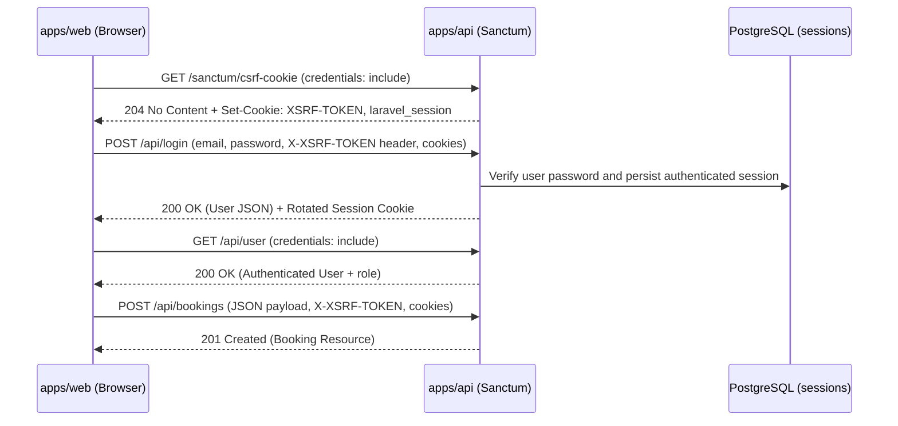

# Authentication and Session Flow

## Strategy Overview

`apps/web` authenticates against `apps/api` using **Laravel Sanctum cookie-based SPA authentication**. No bearer tokens are stored in `localStorage` or `sessionStorage`.

## Required Cross-App Configuration

| Layer | File / Variable | Required Target Setting |
| :--- | :--- | :--- |
| Frontend API Origin | `apps/web/.env` (`VITE_API_URL`) | API origin (for example `http://localhost:8000` locally, `https://api.markedbyfrancene.com` in prod) |
| API Stateful Middleware | `apps/api/bootstrap/app.php` | Enable `$middleware->statefulApi()` |
| API CORS Policy | `apps/api/config/cors.php` | `'supports_credentials' => true`, `'allowed_origins' => [env('FRONTEND_URL')]`, `'paths' => ['api/*', 'sanctum/csrf-cookie']` |
| Sanctum Stateful Domains | `apps/api/config/sanctum.php` (`SANCTUM_STATEFUL_DOMAINS`) | Include SPA host and port (`localhost:5173` locally; production SPA domain) |
| Session Cookies | `apps/api/config/session.php` | `SESSION_DOMAIN` covering shared parent domain in production when SPA and API use subdomains (`app.` / `api.`), `SameSite=Lax`, `Secure=true` over HTTPS |

Note: In the starter `apps/api` scaffold, `config/cors.php` currently sets `'supports_credentials' => false` and `bootstrap/app.php` does not yet call `$middleware->statefulApi()`. Updating both is a mandatory implementation prerequisite.

## Login and CSRF Handshake Sequence

## Security Invariants

- Every mutating request (`POST`, `PUT`, `PATCH`, `DELETE`) from `apps/web` must send `credentials: 'include'` and mirror the URL-decoded `XSRF-TOKEN` cookie into the `X-XSRF-TOKEN` HTTP header.
- On HTTP `419` (CSRF token mismatch/expired), the SPA API client re-fetches `/sanctum/csrf-cookie` once before prompting or retrying safely.
- On HTTP `401` (expired or missing session), the SPA clears cached `['auth', 'user']` state and redirects protected routes to `/login`.
