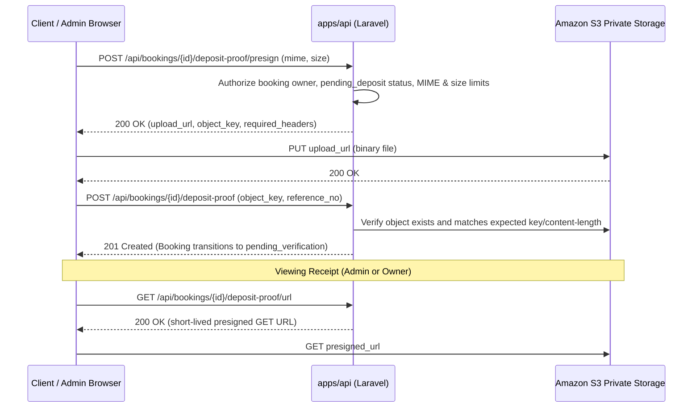

# Storage and CDN Architecture

## Media Classification

**Marked by Francene** strictly separates sensitive operational attachments from public marketing media using distinct Amazon S3 storage policies:

| Media Type | Visibility | S3 Path Prefix | Access Mechanism | Cache Policy |
| :--- | :--- | :--- | :--- | :--- |
| **Deposit Proof Receipts** | Strictly Private | `private/deposits/{booking_id}/{uuid}.{ext}` | Presigned `PUT` (upload) and 10-minute Presigned `GET` (view) | `Cache-Control: private, no-store` |
| **Client Inspo Photos** | Strictly Private | `private/inspo/{booking_id}/{uuid}.{ext}` | Presigned `PUT` (upload) and 10-minute Presigned `GET` (view) | `Cache-Control: private, no-store` |
| **Portfolio Lookbook Images** | Public | `public/portfolio/{uuid}.{ext}` | Admin upload via API or presigned URL; read via CDN HTTPS | `Cache-Control: public, max-age=31536000, immutable` |

## Private Media Flow (Receipts and Inspo)

## Public Portfolio Media and CDN Caching

1. Studio Admin uploads a portfolio image (`JPEG`, `PNG`, or `WEBP`), which `apps/api` validates and stores under an immutable UUID key (`public/portfolio/{uuid}.{ext}`).
2. Because every new or replaced image receives a brand-new UUID key, the CDN edge caches each image with `max-age=31536000, immutable` without stale cache invalidation headaches.
3. Updating a lookbook photo writes a new object key, updates the database URL reference, and deletes the superseded S3 object asynchronously.
4. S3 bucket policies block all `s3:GetObject` public access on `private/*` prefixes; only IAM credentials held by `apps/api` can mint presigned URLs.
