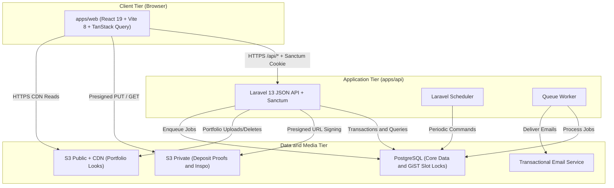

# System Architecture

## Architectural Style

**Marked by Francene** uses a decoupled **Single-Page Application + Stateful JSON API** architecture inside a single Git repository:

- **`apps/web` (Client Tier):** React 19 + TypeScript 6 + Vite 8 + Tailwind CSS v4 SPA responsible for presentation, client-side routing, state/cache coordination, and direct-to-S3 media uploads via presigned URLs.
- **`apps/api` (Application & Domain Tier):** Laravel 13 + PHP 8.3 JSON API responsible for authentication, authorization policies, dynamic schedule calculation, transactional slot locking, booking workflow state transitions, and presigned S3 URL issuance.
- **`apps/api` Background Processes (Async Tier):** Laravel Queue Worker and Scheduler handling hold expirations, transactional emails, and scheduled appointment reminders.
- **Backing Infrastructure:** PostgreSQL (pgAdmin 4 locally; Neon or Supabase in production), Amazon S3 (private storage for receipts/inspo + public CDN-fronted prefix for portfolio), and SMTP/transactional email provider.

## Key Cross-App Principles

- **Separation of Concerns:** UI markup and client state remain exclusively in `apps/web`; domain validation, pricing calculations, slot availability, and persistence remain exclusively in `apps/api`.
- **Single Source of Truth:** Server responses dictate booking totals, hold deadlines, and transition eligibility; frontend validation only mirrors UX constraints.
- **Zero-Proxy Binary Uploads:** Large deposit receipts and client inspo photos upload straight from the browser to private S3 using API-signed presigned URLs, avoiding PHP worker saturation.
