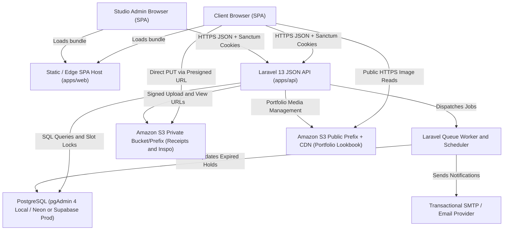

# System Context

## Boundary Overview

**Marked by Francene** operates as a decoupled web application made of a browser-executed React SPA (`apps/web`) communicating over HTTPS with a stateful Laravel JSON API (`apps/api`). Persistent state, object media, and outbound email are delegated to dedicated backing services.

## External Dependencies and Responsibilities

| External System | Interaction Pattern | Purpose |
| :--- | :--- | :--- |
| **PostgreSQL** (`pgAdmin 4` locally; `Neon` or `Supabase` in production) | TCP / TLS SQL over PDO (`pgsql`) | Primary relational store for users, catalog, schedules, bookings, reviews, and atomic slot-locking constraints. |
| **Amazon S3 (Private)** | Presigned `PUT` and short-lived presigned `GET` URLs generated by `apps/api` | Secure storage of sensitive downpayment receipts and client inspiration photos without public exposure. |
| **Amazon S3 + CDN (Public)** | Server-managed upload, immutable object keys served over CDN HTTPS | Fast global caching and delivery of public portfolio lookbook imagery. |
| **Transactional Email Service** | SMTP or provider API triggered from Laravel Queue Worker | Reliable asynchronous delivery of verification emails, booking status updates, and reminders. |
