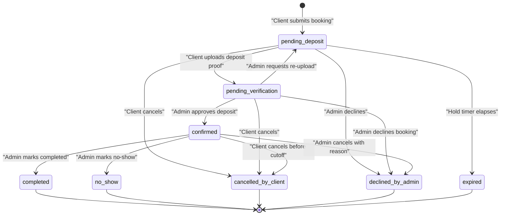

# Booking State Machine

## Status Definitions

| Status | Holds Slot? | Terminal? | Description |
| :--- | :--- | :--- | :--- |
| `pending_deposit` | Yes | No | Reservation submitted; slot temporarily locked until `hold_expires_at` while awaiting receipt upload. |
| `pending_verification` | Yes | No | Client uploaded deposit proof; slot remains locked pending Studio Admin verification. |
| `confirmed` | Yes | No | Deposit approved by Admin; appointment is scheduled and eligible for reminders. |
| `completed` | No (past) | Yes | Service fulfilled; unlocks client eligibility to submit a verified review. |
| `cancelled_by_client` | No | Yes | Cancelled by client within allowed rules; occupied slot released immediately. |
| `declined_by_admin` | No | Yes | Rejected or cancelled by Admin; occupied slot released immediately. |
| `expired` | No | Yes | `hold_expires_at` elapsed before deposit proof upload; occupied slot released automatically. |
| `no_show` | No (past) | Yes | Client did not attend the confirmed appointment; terminal status. |

## State Transitions

## Transition Guards

- **Rescheduling (`pending_deposit`, `pending_verification`, `confirmed`):** Preserves the current status, enforces cutoff and `reschedule_count` limits for clients, acquires a transaction lock on the target slot, updates `start_at` / `end_at` / `occupied_*` timestamps, and increments `reschedule_count`.
- **Re-upload Loop (`pending_verification` -> `pending_deposit`):** Requires a non-empty `rejection_reason`, marks the active `deposit_proofs` row as `rejected`, and grants a fresh `hold_expires_at` window so the client can submit a clear receipt without losing the slot.
- **No Backward Resurrection:** Once a booking enters any terminal state (`completed`, `cancelled_by_client`, `declined_by_admin`, `expired`, `no_show`), no endpoint may reactivate it; clients must create a new booking.
