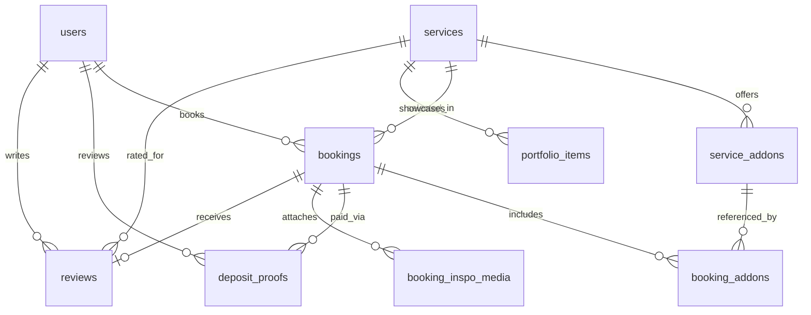

# Database Schema (PostgreSQL)

## Entity-Relationship Overview



## Core Tables

### `users`

- `id` (`bigint`, PK)
- `name` (`varchar(120)`)
- `email` (`varchar(255)`, unique)
- `phone` (`varchar(30)`, nullable)
- `role` (`varchar(20)`, default `'client'`, check `'client' | 'admin'`)
- `email_verified_at` (`timestamptz`, nullable)
- `password` (`varchar(255)`)
- `remember_token` (`varchar(100)`, nullable)
- `created_at`, `updated_at` (`timestamptz`)

### `services`

- `id` (`bigint`, PK)
- `name` (`varchar(120)`)
- `slug` (`varchar(140)`, unique)
- `category` (`varchar(60)`)
- `description` (`text`)
- `duration_minutes` (`integer`, `> 0`)
- `base_price_centavos` (`integer`, `>= 0`)
- `deposit_centavos` (`integer`, `>= 0`)
- `allows_studio` (`boolean`, default `true`)
- `allows_on_location` (`boolean`, default `true`)
- `on_location_fee_centavos` (`integer`, default `0`)
- `is_active` (`boolean`, default `true`)
- `sort_order` (`integer`, default `0`)
- `created_at`, `updated_at` (`timestamptz`)

### `service_addons`

- `id` (`bigint`, PK)
- `service_id` (`bigint`, FK -> `services.id`, nullable for global add-ons or scoped per service)
- `name` (`varchar(120)`)
- `description` (`varchar(255)`, nullable)
- `price_centavos` (`integer`, `>= 0`)
- `extra_minutes` (`integer`, `>= 0`, default `0`)
- `max_quantity` (`integer`, `>= 1`, default `1`)
- `is_active` (`boolean`, default `true`)
- `created_at`, `updated_at` (`timestamptz`)

### `availability_rules`

- `id` (`bigint`, PK)
- `day_of_week` (`smallint`, `0..6` where `0 = Sunday`)
- `start_time` (`time`, interpreted in `Asia/Manila`)
- `end_time` (`time`, interpreted in `Asia/Manila`, `> start_time`)
- `is_active` (`boolean`, default `true`)
- `created_at`, `updated_at` (`timestamptz`)

### `availability_overrides`

- `id` (`bigint`, PK)
- `date` (`date`, unique, interpreted in `Asia/Manila`)
- `is_closed` (`boolean`, default `false`)
- `start_time` (`time`, nullable, required when `is_closed = false`)
- `end_time` (`time`, nullable, required when `is_closed = false`)
- `reason` (`varchar(255)`, nullable)
- `created_at`, `updated_at` (`timestamptz`)

### `bookings`

- `id` (`bigint`, PK)
- `reference_code` (`varchar(20)`, unique)
- `user_id` (`bigint`, FK -> `users.id`)
- `service_id` (`bigint`, FK -> `services.id`)
- `service_name_snapshot` (`varchar(120)`)
- `venue_type` (`varchar(20)`, check `'studio' | 'on_location'`)
- `venue_address` (`text`, nullable)
- `client_notes` (`text`, nullable)
- `start_at` (`timestamptz`)
- `end_at` (`timestamptz`)
- `occupied_start_at` (`timestamptz`)
- `occupied_end_at` (`timestamptz`)
- `total_duration_minutes` (`integer`)
- `base_price_centavos` (`integer`)
- `addons_total_centavos` (`integer`)
- `travel_fee_centavos` (`integer`)
- `total_centavos` (`integer`)
- `deposit_required_centavos` (`integer`)
- `status` (`varchar(30)`)
- `hold_expires_at` (`timestamptz`, nullable)
- `reschedule_count` (`smallint`, default `0`)
- `cancellation_reason` (`text`, nullable)
- `reminder_24h_sent_at` (`timestamptz`, nullable)
- `created_at`, `updated_at` (`timestamptz`)

### `booking_addons`

- `id` (`bigint`, PK)
- `booking_id` (`bigint`, FK -> `bookings.id`, cascade delete)
- `service_addon_id` (`bigint`, FK -> `service_addons.id`)
- `name_snapshot` (`varchar(120)`)
- `quantity` (`integer`, `>= 1`)
- `unit_price_centavos` (`integer`)
- `extra_minutes_per_unit` (`integer`)
- `line_total_centavos` (`integer`)

### `deposit_proofs`

- `id` (`bigint`, PK)
- `booking_id` (`bigint`, FK -> `bookings.id`, cascade delete)
- `object_key` (`varchar(500)`)
- `mime_type` (`varchar(100)`)
- `file_size_bytes` (`integer`)
- `payment_reference` (`varchar(120)`, nullable)
- `amount_centavos` (`integer`, nullable)
- `status` (`varchar(20)`, check `'pending' | 'approved' | 'rejected'`)
- `rejection_reason` (`text`, nullable)
- `reviewed_by` (`bigint`, FK -> `users.id`, nullable)
- `reviewed_at` (`timestamptz`, nullable)
- `created_at`, `updated_at` (`timestamptz`)

### `booking_inspo_media`

- `id` (`bigint`, PK)
- `booking_id` (`bigint`, FK -> `bookings.id`, cascade delete)
- `object_key` (`varchar(500)`)
- `mime_type` (`varchar(100)`)
- `file_size_bytes` (`integer`)
- `caption` (`varchar(255)`, nullable)
- `created_at`, `updated_at` (`timestamptz`)

### `portfolio_items`

- `id` (`bigint`, PK)
- `service_id` (`bigint`, FK -> `services.id`, nullable)
- `title` (`varchar(140)`)
- `category` (`varchar(60)`)
- `caption` (`text`, nullable)
- `object_key` (`varchar(500)`)
- `public_url` (`varchar(600)`)
- `sort_order` (`integer`, default `0`)
- `is_published` (`boolean`, default `true`)
- `created_at`, `updated_at` (`timestamptz`)

### `reviews`

- `id` (`bigint`, PK)
- `booking_id` (`bigint`, FK -> `bookings.id`, unique)
- `user_id` (`bigint`, FK -> `users.id`)
- `service_id` (`bigint`, FK -> `services.id`)
- `rating` (`smallint`, check `1..5`)
- `comment` (`text`)
- `is_published` (`boolean`, default `false`)
- `moderated_at` (`timestamptz`, nullable)
- `created_at`, `updated_at` (`timestamptz`)

## Critical PostgreSQL Constraints and Indexes

- **Double-Booking Exclusion Constraint (`bookings`):**
  Requires `CREATE EXTENSION IF NOT EXISTS btree_gist;` and prevents overlapping occupied intervals for active statuses:
  ```sql
  ALTER TABLE bookings
  ADD CONSTRAINT bookings_no_overlapping_active_slots
  EXCLUDE USING gist (
      tstzrange(occupied_start_at, occupied_end_at, '[)') WITH &&
  )
  WHERE (status IN ('pending_deposit', 'pending_verification', 'confirmed'));
  ```
- **Hold Expiry Sweep Index:** `CREATE INDEX idx_bookings_hold_expiry ON bookings (hold_expires_at) WHERE status = 'pending_deposit';`
- **Client History Index:** `CREATE INDEX idx_bookings_user_start ON bookings (user_id, start_at DESC);`
- **Public Reviews Index:** `CREATE INDEX idx_reviews_published ON reviews (is_published, created_at DESC);`
