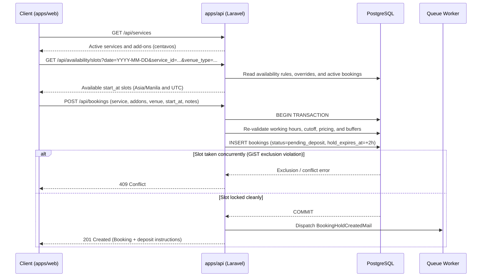

# Workflow: Client Booking Creation

## Trigger

An authenticated, email-verified client opens `/book` in `apps/web` to schedule a makeup appointment.

## Sequence Diagram

## Operational Steps

1. Client selects a makeup service, optional add-ons/quantities, and venue type (`studio` or `on_location` with venue address).
2. Client picks an available date and start time rendered in `Asia/Manila` (`PHT`).
3. Client reviews the itemized PHP breakdown (base price, add-ons, travel fee, total, and required downpayment) and submits.
4. `apps/api` computes authoritative totals and occupied `[occupied_start_at, occupied_end_at)` bounds on the server inside a PostgreSQL transaction.
5. Upon commit, the booking enters `pending_deposit` with a temporary hold timer (`hold_expires_at`) and displays payment instructions on `/bookings/:id`.
6. If another client claims an overlapping slot milliseconds earlier, PostgreSQL's exclusion constraint blocks the duplicate write and `apps/api` returns HTTP `409 Conflict`, prompting the client to refresh open slots.
