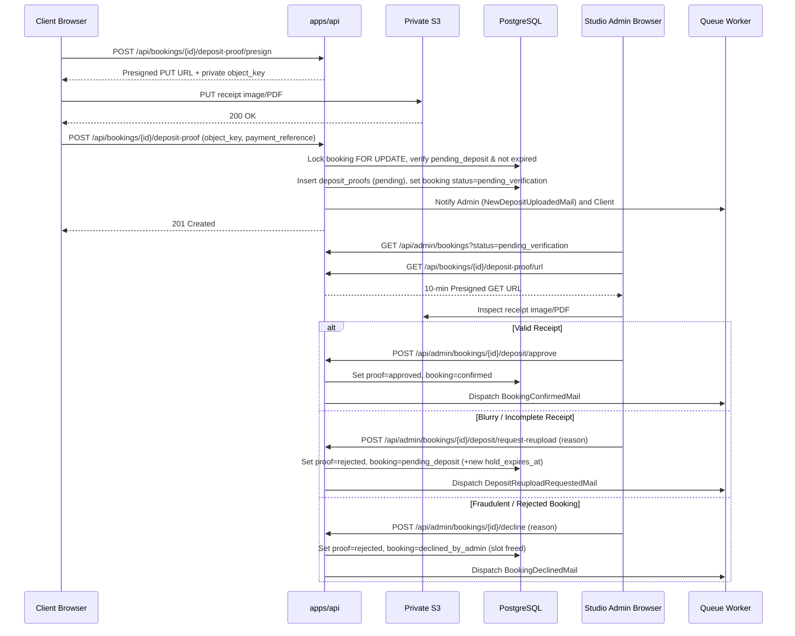

# Workflow: Deposit Verification

## Trigger

A client with a `pending_deposit` booking transfers the required downpayment via bank or e-wallet and uploads the receipt before `hold_expires_at`.

## Sequence Diagram

## Concurrency & Edge-Case Guards

- `apps/api` acquires a `SELECT ... FOR UPDATE` lock on the booking row when recording the receipt, preventing a race condition where the hold-expiration command expires the booking mid-upload.
- Only `pending_deposit` bookings with `hold_expires_at > now()` accept new receipt uploads.
- Rejecting a proof without a clear `rejection_reason` is blocked at request validation (`422`).
